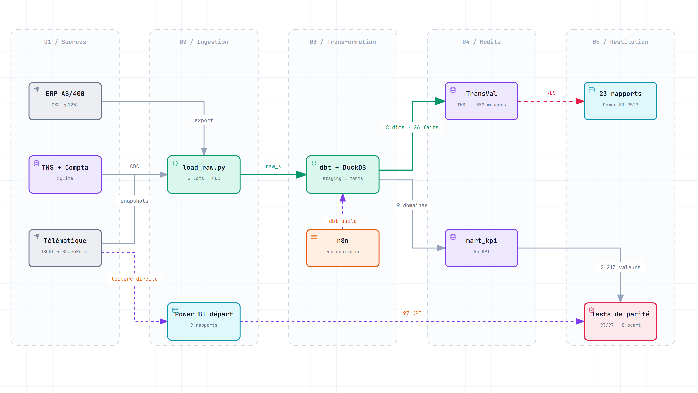
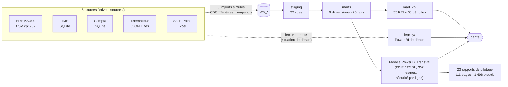
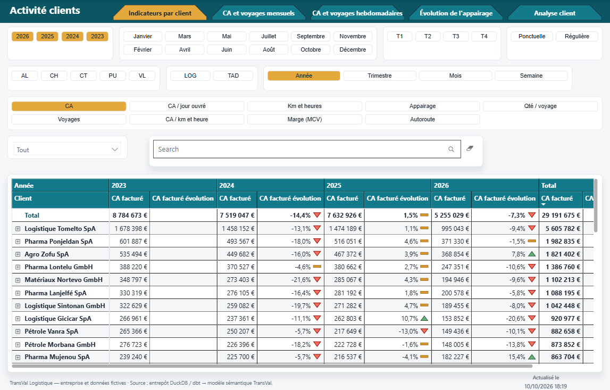
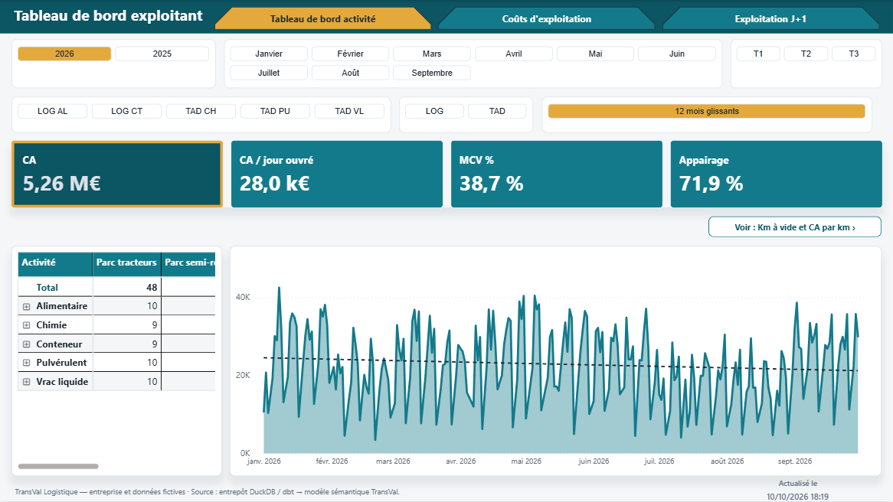
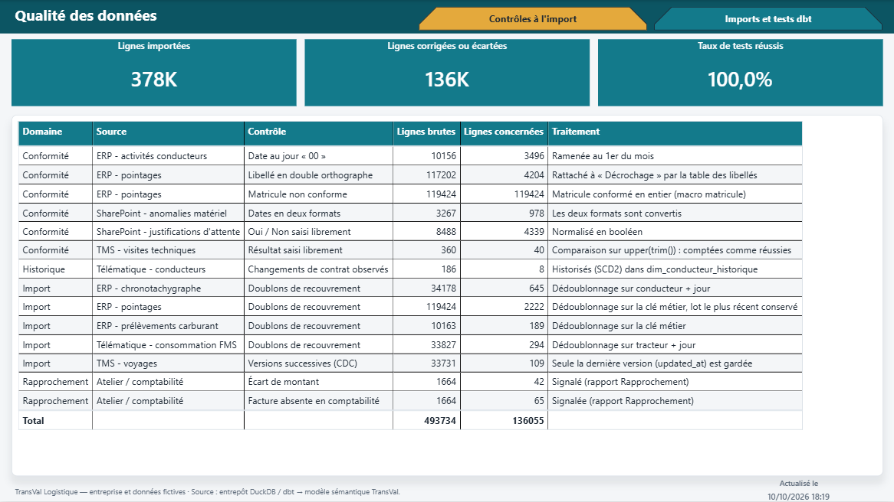
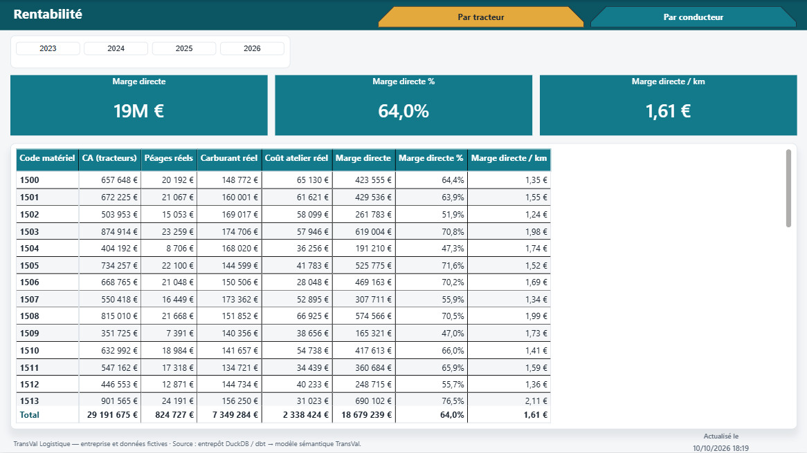

# Projet 21 — Intégrer Power BI dans un transporteur : de l'outil « tout-en-un » à un entrepôt de pilotage
[](https://github.com/valentinratigniet-byte/projet-21-entrepot-transport/actions/workflows/ci.yml)

> **En une phrase** : chez **TransVal Logistique**, transporteur citerne fictif d'Auvergne-Rhône-Alpes, Power BI est
> branché en direct sur six systèmes de gestion et chaque rapport refait son propre nettoyage. Le projet met en place un
> **entrepôt DuckDB + dbt** entre les sources et Power BI, prouve qu'il donne **les mêmes chiffres, KPI par KPI, en
> corrigeant ce qui était faux**, puis livre un **modèle sémantique unique** et **23 rapports de pilotage, un par
> sujet**, avec sécurité par ligne, actualisation quotidienne supervisée et déploiement « as code ».

## 🎯 Problématique

Dans beaucoup de PME du transport, Power BI devient l'entrepôt de données par défaut : chaque nouveau besoin ajoute un
rapport, ses requêtes sur l'ERP, ses colonnes calculées et ses mesures. C'est la situation de départ de TransVal :

| Symptôme | Conséquence pour le pilotage |
|---|---|
| Chaque rapport recharge les mêmes tables, avec ses propres filtres | **deux rapports, deux chiffres** pour les mêmes heures de chargement |
| Mesures recopiées d'un rapport à l'autre | une règle corrigée à un endroit reste fausse ailleurs |
| `TODAY()` dans les mesures, fenêtre glissante en SQL | un chiffre ne peut être ni rejoué, ni testé |
| Nettoyage au moment de l'affichage (`TRIM`, accents, casse, matricules) | une saisie `valide ` ou `VALIDE` compte comme un refus |
| Six systèmes de production interrogés à chaque actualisation | actualisation lente, aucune trace de ce qui a été chargé |
| Aucune sécurité, aucun test | tout le monde voit tout ; une erreur se voit dans le rapport, ou jamais |

Détail : [docs/01-situation-de-depart.md](docs/01-situation-de-depart.md).

> 🔒 **Entreprise et données entièrement fictives.** Les noms de conducteurs, mécaniciens et clients sont inventés
> syllabe par syllabe, puis écartés s'ils existent (ou presque) dans les fichiers INSEE des prénoms et des noms de famille.

## 🧭 Démarche en 7 temps

0. **Spécification fonctionnelle** : objectifs, utilisateurs, 23 récits utilisateur avec critères d'acceptation, 12 règles
   de gestion, recette → [00-specification-fonctionnelle.md](docs/00-specification-fonctionnelle.md)
1. **Situation de départ** : sources, rapports et défauts → [01-situation-de-depart.md](docs/01-situation-de-depart.md)
2. **Fonctionnement avant / après** : 6 systèmes sources simulés avec leurs défauts de format, le Power BI de départ
   reproduit tel quel (Power Query + DAX, incohérences comprises), l'entrepôt → [02-fonctionnement.md](docs/02-fonctionnement.md)
3. **Ce que l'entrepôt change**, constat par constat, et les corrections chiffrées → [03-ameliorations.md](docs/03-ameliorations.md)
4. **Chaque transformation et chaque mesure** déplacée de Power BI vers l'entrepôt →
   [04-correspondance-powerbi-entrepot.md](docs/04-correspondance-powerbi-entrepot.md)
5. **Power BI** : modèle sémantique PBIP/TMDL généré, 23 rapports de pilotage par sujet, sécurité par ligne,
   déploiement fabric-cicd → [05-power-bi.md](docs/05-power-bi.md)
6. **Exploitation** : chargement **incrémental** lot par lot (prouvé égal à un recalcul complet), fraîcheur des sources,
   **lignage dbt jusqu'aux 23 rapports**, **orchestration et alertes n8n** → [06-exploitation.md](docs/06-exploitation.md)

## 🏗️ Architecture



**[Ouvrir le schéma interactif](https://htmlpreview.github.io/?https://github.com/valentinratigniet-byte/projet-21-entrepot-transport/blob/main/docs/architecture.html)** (zoom, recherche, suivi des flux, export PNG/SVG). Généré avec [Archify](https://github.com/tt-a1i/archify) depuis [`docs/architecture.archify.json`](docs/architecture.archify.json).



| Couche | Contenu |
|---|---|
| `sources/` | 33 622 voyages, 117 202 pointages, 2 930 interventions atelier, frais conducteurs, compta, télématique… 2023 → 30/09/2026, graines fixes |
| `ingestion/load_raw.py` | 3 lots (≈ 378 000 lignes), chargés un par un : recouvrements → doublons, CDC → plusieurs versions d'un voyage, photos des référentiels et listes SharePoint à la date du lot |
| `dbt/models/staging` | typage, formats (AAAAMMJJ, virgule décimale, JJ/MM/AAAA, demi-minutes), **matricule conformé** sur 5 formats, dédoublonnage |
| `dbt/models/marts` | constellation : date, conducteur (+ historique SCD2), matériel, client (indexation gazole), relation (coordonnées), ville, activité + faits (voyage et pointage **incrémentaux**), rentabilité réelle, qualité des données ; 23 exposures (rapports Power BI) |
| `dbt/models/marts/kpi` | 9 domaines → `mart_kpi` (valeur + numérateur/dénominateur) |
| `legacy/rapports_powerbi.py` | le Power BI de départ : 9 rapports (un par domaine) qui lisent les sources en direct, logique Power Query + DAX |
| `powerbi/` | modèle `TransVal` généré (`build_model.py`, `mesures.py`), 23 rapports `.pbip`, contrôles statiques (`verifier_rapports.py`), déploiement (`deployer.py`, `parameter.yml`), lignage (`exposures_dbt.py`) |
| `tests/` | parité Power BI de départ ↔ entrepôt (Python) et entrepôt ↔ nouveau modèle (`parite_powerbi.dax`) |
| `ops/`, `n8n/` | rapport d'exécution (tests, parité, fraîcheur, seuils qualité) et workflows n8n d'actualisation quotidienne et d'alerte |

## 📊 Résultats

- **Power BI de départ ↔ entrepôt : 93 / 97 KPI identiques au centime près**, malgré des imports incrémentaux avec
  doublons et corrections tardives. **Les 4 autres sont des corrections voulues, prouvées** : le test recalcule l'écart
  depuis l'entrepôt et vérifie qu'il s'explique exactement.
- **Entrepôt ↔ nouveau modèle Power BI : 2 213 valeurs (53 KPI × toutes les périodes), 0 écart.**
- **23 rapports de pilotage** (111 pages, 1 698 visuels), un par sujet, ouverts et vérifiés dans Power BI Desktop ;
  contrôles statiques en CI : 0 champ inconnu, 0 erreur de type de filtre, 0 lien entre rapports sans règle de déploiement.

| Correction | Power BI de départ | Entrepôt / nouveau modèle |
|---|---|---|
| Heures de chargement/déchargement, août 2026 (un rapport comptait les corrections manuelles, l'autre non) | 1 343,5 h | 1 286,2 h (une seule définition) |
| Taux de réussite visite technique 2026 (`= "Valide"` strict ratait `valide `, `VALIDE`) | 75,0 % | 87,5 % |
| Projection d'heures (`NETWORKDAYS` sans fériés) / consommation (moyenne de ratios) | conservées | + versions hors fériés / pondérée |

| | Power BI de départ | Entrepôt + modèle TransVal |
|---|---|---|
| Logique de calcul | répartie entre SQL natif, Power Query et DAX, recopiée par rapport | dans l'entrepôt, écrite une fois et testée ; 0 colonne calculée, 0 étape Power Query |
| Mesures | recopiées rapport par rapport | 352, une définition chacune, variantes N-1 générées |
| `TODAY()` | dans les mesures et le SQL | 0 (date de référence) |
| Rapports | une page d'accueil qui aiguille vers tous les sujets | 23 rapports par sujet, noms clairs, liens résolus au déploiement |
| Sécurité | aucune | sécurité par ligne dynamique : un exploitant ne voit que ses activités |
| Tests | 0 | 48 tests dbt (dont incrémental = recalcul complet, fraîcheur) + 3 contrôles de parité + contrôles des rapports, en CI ; résultats visibles dans le rapport Qualité |
| Exploitation | actualisation manuelle, 6 systèmes interrogés en direct | imports incrémentaux, actualisation quotidienne n8n, e-mail seulement en cas d'alerte ou d'échec |
| Déploiement | manuel depuis Desktop | fabric-cicd + workflow GitHub manuel DEV / PROD |

Pipeline complet (sources → 3 lots importés, chacun suivi d'un `dbt build` 140/140 — complet puis incrémental → Power BI
de départ → parité) en **≈ 2 minutes**.

## 🖼️ Aperçu

| Indicateurs par client (segment de thème : CA, km, marge, appairage…) | Tableau de bord exploitant |
|---|---|
|  |  |
| **Qualité des données** (ce que l'entrepôt absorbe à chaque import) | **Rentabilité** (marge directe sur coûts réels) |
|  |  |

*Données entièrement fictives (TransVal Logistique). Les 23 rapports en images : [docs/05-power-bi.md](docs/05-power-bi.md#aperçu-des-23-rapports).*

## 🛠️ Stack

Python 3.12 · DuckDB · dbt-core + dbt-duckdb (modèles incrémentaux, exposures) · pandas · Power BI Desktop (PBIP, TMDL, PBIR) ·
fabric-cicd · n8n · GitHub Actions.

## ▶️ Lancer

```bash
python -m venv .venv && .venv/Scripts/activate      # (Linux/macOS : source .venv/bin/activate)
pip install -r requirements.txt
python run_all.py                  # sources -> 3 lots (import + dbt build) -> Power BI de départ -> parité
python powerbi/build_model.py      # Parquet + modèle Power BI (TRANSVAL_DONNEES = chemin de powerbi/donnees, facultatif)
python ops/rapport_execution.py    # état de l'actualisation : tests, parité, fraîcheur, seuils qualité
```

Puis ouvrir `powerbi/TransVal.pbip` ou l'un des 23 rapports `powerbi/<Rapport>.pbip` dans Power BI Desktop
(**Transformer les données → Paramètres → DossierDonnees** = chemin de `powerbi/donnees`, puis **Actualiser**).
Orchestration quotidienne : importer les workflows de `n8n/` (voir [06-exploitation.md](docs/06-exploitation.md)).

## ⚠️ Limites

Données et imports simulés (fichiers et SQLite au lieu de vrais connecteurs DB2/Oracle/SharePoint) ; le Power BI de
départ est reproduit sur 9 rapports (un par domaine), suffisant pour la parité ; le déploiement fabric-cicd est prêt mais
non exécuté (pas de tenant) ; DuckDB à la place d'un SQL Server de production. Détail et pistes dans
[03-ameliorations.md](docs/03-ameliorations.md#ce-que-lentrepôt-ne-corrige-pas-limites-assumées).
