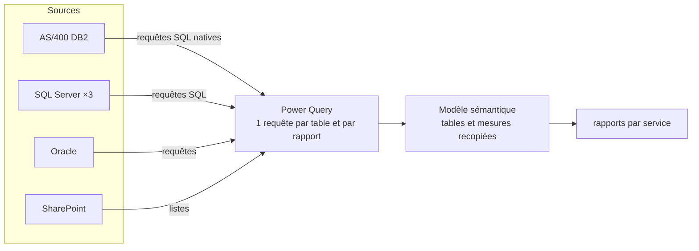
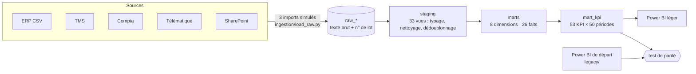

# 2. Fonctionnement — comment marche le système (avant / après)

## Avant : Power BI branché en direct sur la production

À chaque actualisation, chaque table relance sa requête sur la production. La logique est répartie sur trois couches :
le SQL natif (conversion des dates AS/400, filtres de périmètre), les étapes Power Query (typage, colonnes ajoutées) et le
DAX (filtres métier, nettoyage, ratios).

Ce fonctionnement est reproduit dans [`legacy/rapports_powerbi.py`](../legacy/rapports_powerbi.py) : neuf fonctions, une par
rapport. Chacune lit les sources **en direct** et applique sa logique Power Query + DAX, en indiquant en commentaire la mesure
qu'elle reproduit. Les incohérences sont conservées volontairement : c'est ce que l'entrepôt doit corriger.

## Les sources fictives

`sources/generate.py` simule « TransVal Logistique », un transporteur citerne fictif (48 tracteurs, 62 conducteurs, 40 clients,
120 relations, 2023 → 30/09/2026), et écrit six systèmes qui gardent chacun **les défauts de format typiques de ce type de système** :

| Système simulé | Format | Défauts reproduits |
|---|---|---|
| `erp/*.csv` (AS/400) | CSV `;` cp1252 | dates `AAAAMMJJ`, secondes, décimales à virgule, champs complétés d'espaces, matricule `0412  ` ou `000412`, `Décrochage`/`Decrochage` |
| `tms.sqlite` (SQL Server) | base relationnelle | voyages corrigés après coup (table d'historique type *temporal table*), relation vide pour les voyages « spot » |
| `compta.sqlite` (Sage) | base relationnelle | n° de pièce texte `FA0070001` vs n° de facture entier côté atelier, écritures manquantes ou erronées |
| `telematique/*.jsonl` (Oracle) | JSON Lines | clés en majuscules, dates `JJ/MM/AAAA`, matricule `C0412` |
| `sharepoint/*.xlsx` | Excel | `Oui`/`oui`/`OUI `, dates Excel mélangées à du texte, cellules vides |
| seeds dbt | CSV | jours fériés, référentiels de libellés |

## Après : un entrepôt entre les sources et Power BI

### 1. Imports simulés — `ingestion/load_raw.py`

Trois lots (31/03/2026, 31/08/2026, 30/09/2026) reproduisent l'historique d'un entrepôt alimenté régulièrement. Chaque type de
source a sa stratégie d'extraction, comme dans un vrai SI :

| Source | Stratégie | Conséquence à gérer en aval |
|---|---|---|
| Exports ERP | fenêtre de dates avec **15 jours de recouvrement** | doublons exacts (119 424 lignes chargées pour 117 202 pointages réels) |
| Voyages TMS | **CDC** sur `updated_at` + table d'historique | plusieurs versions d'un même voyage (109 régularisations) |
| Compta | append-only sur la date de pièce | — |
| Télématique | fenêtre avec 7 jours de recouvrement | doublons |
| SharePoint, référentiels | snapshot complet à chaque lot | ne garder que le dernier lot |

La couche RAW garde **tout, en texte**, avec `_batch_id`, `_loaded_at`, `_source`, et un journal `raw_meta.import_log`
(≈ 378 000 lignes sur les 3 lots).

### 2. Staging — `dbt/models/staging/` (33 vues)

Un modèle par table source. Typage, conversion des formats (macros `aaaammjj`, `nombre_fr`, `jjmmaaaa`), conformation du
matricule (macro `matricule` : `000412`, `0412  `, `412`, `C0412`, `412.0` → `412`), et dédoublonnage :
macro `dedup` (dernier lot par clé métier, ou dernière version CDC) et `latest_snapshot` (listes).

### 3. Marts — `dbt/models/marts/`

- **8 dimensions conformes** : date (fériés, jours ouvrés, indicateurs relatifs), conducteur, matériel, tracteur, client (avec indexation gazole), relation (avec coordonnées), ville, activité.
- **17 tables de faits**, une par processus métier : voyage, pointage, chrono, compteur de paie, affectation, intervention
  atelier, visite technique, carburant, consommation FMS, absence, infraction, autoroute interdite, accident du travail, anomalie
  matériel, événement facturé, justification d'attente, rapprochement atelier/compta.
- Les règles métier deviennent des **colonnes** calculées une fois (`est_valide`, `est_saisie_exploitation`, `categorie_hchc`,
  `mcv_marge_retenue`, `km_vide_eur`, `statut` de rapprochement…) ou des **seeds** versionnés (catégories de pointage, familles
  exclues de la sous-traitance).

### 4. KPI — `mart_kpi`

Neuf modèles `kpi_<domaine>` calculent les indicateurs pour **toutes** les périodes (chaque mois, chaque année à date, total)
et les rassemblent dans une table longue `(domaine, kpi, periode, valeur, numerateur, denominateur)`. Le numérateur et le
dénominateur permettent à Power BI de ré-agréger un ratio correctement (somme des numérateurs / somme des dénominateurs),
au lieu d'additionner des pourcentages.

`as_of` (variable dbt, ici le 30/09/2026) remplace `TODAY()` : un chiffre rejoué donne toujours le même résultat.

### 5. Contrôle — `tests/test_parity.py` + 48 tests dbt

- **Parité** : les 97 KPI du Power BI de départ sont comparés à `mart_kpi`. 93 sont identiques ; les 4 autres sont les
  corrections voulues (voir [3. Améliorations](03-ameliorations.md)), dont le test **recalcule l'écart** pour prouver qu'il
  s'explique exactement.
- **Tests dbt** : unicité/non-nullité des clés, matricule de chaque fait rattaché au référentiel conducteurs (les 5 formats
  convergent), chaque libellé de pointage rattaché à une catégorie, statuts autorisés, aucun voyage perdu ni dupliqué par les
  imports, grain unique de `mart_kpi`.

→ Suite : [3. Améliorations](03-ameliorations.md)
