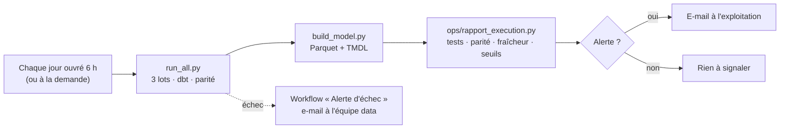

# 6. Exploitation — chargement incrémental, lignage, fraîcheur, orchestration n8n

L'entrepôt ne se contente pas de calculer juste une fois : il est conçu pour tourner tous les jours, sans intervention, et
pour prévenir quand quelque chose dérive.

## Un import, puis une mise à jour de l'entrepôt — lot par lot

[`run_all.py`](../run_all.py) rejoue la vie réelle de l'entrepôt : chaque lot d'import est suivi d'un `dbt build`, à la date
du lot (variable `as_of`), comme si le traitement tournait ce jour-là.

| Lot | Date | Lignes chargées en RAW | `dbt build` |
|---|---|---|---|
| 1 | 31/03/2026 | ≈ 280 000 (historique) | **complet** (`--full-refresh`) — 140/140 |
| 2 | 31/08/2026 | ≈ 60 000 (delta) | **incrémental** — 140/140 |
| 3 | 30/09/2026 | ≈ 38 000 (delta) | **incrémental** — 140/140 |

**Modèles incrémentaux** (stratégie `delete+insert` sur la clé métier, filigrane = n° de lot d'import) :

- [`int_voyage_courant`](../dbt/models/intermediate/int_voyage_courant.sql) applique le CDC du TMS : un nouveau lot n'apporte
  que les voyages créés ou modifiés depuis le précédent ; la nouvelle version remplace l'ancienne.
- [`fct_pointage`](../dbt/models/marts/fct_pointage.sql) : seuls les pointages du nouveau lot (nouveaux ou ré-exportés par
  la fenêtre de recouvrement) sont traités.

Le test [`incremental_egal_recalcul_complet`](../dbt/tests/incremental_egal_recalcul_complet.sql) compare, à chaque lot, ces
tables alimentées petit à petit avec un recalcul complet depuis le staging : aucune ligne en trop, en moins ou différente.
`fct_voyage` reste une table complète : ses écarts à la médiane de chaque relation portent sur tout l'historique.

Les photos de référentiels et de listes SharePoint sont elles aussi prises **à la date du lot** : une justification n'existe
pas avant le voyage qu'elle justifie, un changement de contrat n'apparaît qu'au lot qui suit sa date d'effet.

## Fraîcheur des sources

- Test [`sources_a_jour`](../dbt/tests/sources_a_jour.sql) : le dernier import de chaque table doit dater au plus de la veille
  de la date de référence (un import sans nouvelle ligne est journalisé quand même).
- `loaded_at_field` + `freshness` déclarés sur les sources ERP et TMS pour `dbt source freshness` en production (horloge
  réelle ; dans la simulation l'horloge est figée sur `as_of`, d'où le test équivalent ci-dessus).

## Lignage jusqu'au rapport : les rapports Power BI déclarés comme « exposures » dbt

[`powerbi/exposures_dbt.py`](../powerbi/exposures_dbt.py) lit chaque rapport, remonte des champs et des mesures DAX utilisés
(récursivement) jusqu'aux tables du modèle, puis jusqu'aux marts dbt, et écrit
[`_exposures.yml`](../dbt/models/marts/_exposures.yml) : **23 exposures**, avec propriétaire métier. Le graphe de `dbt docs`
va ainsi de la source jusqu'au rapport, et `dbt ls --select +exposure:rapport_rentabilite` répond à « si je modifie cette
source, quels rapports sont touchés ? ». La CI vérifie que le fichier est à jour.

## Orchestration et alertes avec n8n

Deux workflows dans [`n8n/`](../n8n) :

| Workflow | Rôle |
|---|---|
| [`actualisation-quotidienne-workflow.json`](../n8n/actualisation-quotidienne-workflow.json) | lance la chaîne complète, lit le rapport d'exécution et n'envoie un e-mail **que** s'il y a une alerte |
| [`alerte-echec-workflow.json`](../n8n/alerte-echec-workflow.json) | workflow d'erreur : si une étape échoue (test dbt bloquant, parité, import), e-mail avec le nœud et l'erreur ; les rapports gardent la dernière actualisation réussie |

La **logique** reste dans du code versionné et testable — [`ops/rapport_execution.py`](../ops/rapport_execution.py) et les
seuils de [`ops/seuils_qualite.json`](../ops/seuils_qualite.json) (modifiables par le métier) ; n8n ne fait qu'orchestrer et
notifier. Chaque exécution laisse un rapport JSON horodaté dans `data/rapports_execution/`.

**Vérifié en local** (n8n 1.123, CLI `n8n execute`, serveur SMTP de test qui capture les e-mails au lieu de les envoyer) :

| Scénario | Résultat |
|---|---|
| Actualisation normale | chaîne complète exécutée (3 lots, 3 `dbt build`, parité, modèle) — statut **OK**, branche « Rien à signaler » |
| Seuil « écart de montant » abaissé à 1 % (sous le taux mesuré) | statut **ALERTE**, e-mail reçu : objet « TransVal - entrepôt : 1 alerte(s) qualité », détail du contrôle, tests, parité, lots |
| Échec simulé d'une étape | e-mail « TransVal - ÉCHEC : … » avec le nœud et le message d'erreur |

**Mise en service** : `TRANSVAL_DIR` = dossier du projet dans l'environnement de n8n ; importer les deux JSON
(`n8n import:workflow --input=…`) ; créer l'identifiant SMTP « SMTP TransVal » ; activer le workflow d'actualisation.
Le nœud *Execute Command* exécute la chaîne Python sur la machine qui héberge n8n (en n8n 2.x il faut l'autoriser :
`NODES_EXCLUDE=[]`).

→ Retour au [README](../README.md)
